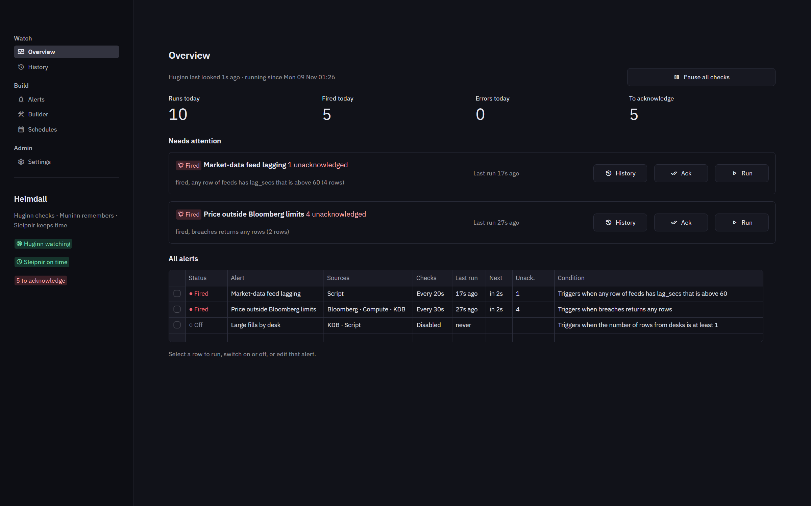

# Heimdall

Heimdall watches for conditions across KDB, Bloomberg and in-house scripts,
and raises an alert when one is met. It is the alerting half of what
KdbMonitor used to do, rebuilt as a standing service so that checks run
whether or not anyone has a browser open. Dashboards stay in KdbMonitor.

| Part | Role |
|---|---|
| **Huginn** | The service: an HTTP API and an engine that runs every enabled alert on its interval, records each run, and sends email notifications. |
| **Muninn** | The store Huginn owns (SQLite): alert definitions, connections, the script registry, schedules, and the history of every run, notification and change. |
| **Sleipnir** | The scheduler: switches alerts on and off, or runs them, at cron times in each schedule's own time zone. |
| **Bifrost** | The Streamlit app (always dark) where alerts are built, watched, and their history read and cleaned up. |
| **Gjallarhorn** | Pop-ups on traders' screens: a small Windows app (PowerShell and WPF, nothing to install) that reads the alerts Huginn writes to a shared folder and writes acknowledgements back. |

In the myth, Heimdall keeps watch over Bifrost, Huginn ("thought") and
Muninn ("memory") are the ravens that fly out each day and report back, and
Sleipnir is Odin's eight-legged horse. The design is in
[docs/design.md](docs/design.md), the setup guide in [docs/SETUP.md](docs/SETUP.md),
and a short presentation in [docs/presentation/Heimdall.pptx](docs/presentation/Heimdall.pptx).



## Run it

The full installation and deployment guide is [docs/SETUP.md](docs/SETUP.md).
To host Heimdall on your own PC for colleagues to use from their browsers, see
[docs/LOCAL-HOSTING.md](docs/LOCAL-HOSTING.md).

```powershell
python -m venv .venv
.venv\Scripts\pip install -e ".[dev,kdb]"
# for Bloomberg B-PIPE (blpapi comes from Bloomberg's package index):
.venv\Scripts\pip install -e ".[dev,kdb,bloomberg]" --extra-index-url https://blpapi.bloomberg.com/repository/releases/python/simple/

.venv\Scripts\python -m heimdall all --demo
```

`all` starts the three processes, writes their logs to `data/logs/`, and stops
them together on Ctrl+C. `--demo` loads a mock KDB server, a fake Bloomberg and
three working alerts, so everything can be tried with no real system. Bifrost
is at http://localhost:8501 and Huginn's API documentation at
http://127.0.0.1:8765/docs.

Each part also runs on its own, which is how they go on separate machines:

```powershell
python -m heimdall huginn [--demo] [--host 0.0.0.0] [--port 8765]
python -m heimdall sleipnir [--url http://huginn-host:8765] [--http]   # local pipe to a Huginn on this machine; --http forces HTTP
python -m heimdall bifrost [--port 8501]
```

Configuration is `heimdall.toml` (copy [heimdall.example.toml](heimdall.example.toml)),
or `HEIMDALL_*` environment variables. The API token is never stored: the
config names the environment variable that holds it. Set `HEIMDALL_TOKEN` on
every machine before Huginn listens on anything but localhost.

## Building an alert

An alert is a chain of named steps. Each step returns a table, and later steps
can use what earlier ones returned.

| Step | Does |
|---|---|
| KDB | A guided query (table, columns, filters) or raw q against a KDB connection. |
| Bloomberg | `bdp` (reference and current values) or `snap` (live values) through B-PIPE. |
| Script | Runs a script registered in Settings and reads JSON, CSV, one value or only the exit code. |
| Compute | Joins two earlier tables, adds columns from expressions, keeps rows where a test holds. |

References to earlier steps:

| Write | In q | In a security line | In a script parameter |
|---|---|---|---|
| `{{orders.sym}}` | `` `AAPL`MSFT `` (a q list) | one line per value | `AAPL,MSFT` |
| `{{orders.sym[0]}}` | `` `AAPL `` | `AAPL` | `AAPL` |
| `{{table:orders}}` | the whole table, to join against | | |
| `{{rows:orders}}` | the row count | the row count | the row count |

A Bloomberg line such as `{{orders.sym}} US Equity` keeps `sym` next to
`security` in its result, so a compute step can join it straight back to
`orders`. The demo alert *Price outside Bloomberg limits* does exactly that: KDB
orders, KDB prices, Bloomberg limit up and down, and a compute step that keeps
the stocks trading through a limit.

The condition judges one step's table (the last by default): any rows, no
rows, a row count, any or every row matching `column op value`, or a total
(min, max, avg, sum, count). The re-arm policy decides whether a run that fires
notifies: when it starts firing, when the result changes, when rows are addedor removed, when a value moved
by an amount or percent since the last notification (per key if wanted), at
most every N minutes, or every run.

An alert can also mail **all clear** (after every clean check, or once a period
when nothing fired or failed), run only during **active hours** (days and time
windows in a time zone, overnight windows included), and belong to a **group**
that Overview and Alerts show together. See [docs/SETUP.md](docs/SETUP.md),
section 9.

### Scripts

Alerts can only run scripts an administrator has registered (Settings →
Scripts). A script is its command as a list of arguments with `{param}`
placeholders. There is no shell, and every parameter stays one argument, so an
alert, including one imported from someone else, cannot run anything that was
not registered. A script can also receive an earlier step's table on stdin as
JSON records. See `examples/scripts/` for three small ones.

## Gjallarhorn: alerts on traders' screens

Traders do not need Bifrost. Every alert has a **severity** (info, warning,
critical: shown in Overview and Alerts, and at the start of a firing's email
subject) and a **sound**, by default a horn call that grows more urgent with the
severity. An alert with **Pop up on traders' screens** on (for every trader or
some desks / Windows user names) makes Huginn write one file per firing to a shared folder. Gjallarhorn,
running on each trader's PC, shows one card at the bottom right (never a stack:
"1 of 4" and arrows), keeps every alert waiting to be acknowledged in a list
with its rows, and writes acknowledgements back to the share; Huginn records
who acknowledged on the run. Acknowledging in Bifrost closes the pop-ups too.

Set up in Bifrost, Settings → Gjallarhorn: the shared folder, *Publish the
app*, *Send a test*, and the one command to run on each trader's PC. See
[docs/SETUP.md](docs/SETUP.md), section 10.

## History

Every check is a run: what started it (interval, schedule, by hand), the
request each step made, how many rows came back, the table the condition
judged (first 200 rows), and every notification attempt. Every change (an
alert edited, switched on by a schedule, history cleaned) is recorded too.

A firing (the run that starts an episode, or one that notified) waits to be
acknowledged. Checks that are still firing on the same problem do not each
ask again. History → Clean up removes runs older than N days, all but the
newest N per alert, or everything for one alert, always showing how much will
go first. An automatic policy can do the same every hour.

## Tests

```powershell
.venv\Scripts\python -m pytest                 # everything, about a minute
.venv\Scripts\python -m pytest -m "not e2e"    # unit and integration only, seconds
```

* **Unit** (`tests/test_refs_expr.py`, `tests/test_steps.py`): references,
  guarded expressions, scripts, compute, conditions, cron, validation, and the
  demo chains.
* **Integration** (`tests/test_service.py`, `tests/test_bifrost.py`): the engine,
  Muninn, the API, Sleipnir and every Bifrost page, wired together in one
  process.
* **End to end** (`tests/e2e/`): starts the real Huginn, Sleipnir and Bifrost,
  with an SMTP server and the built-in fake Bloomberg, and takes
  an alert through a test run, the engine, email delivery, error
  and recovery notifications, a cron schedule, history cleanup and a Huginn
  restart.

KDB is exercised through the built-in mock: a real kdb+ needs a licence and a
server.
